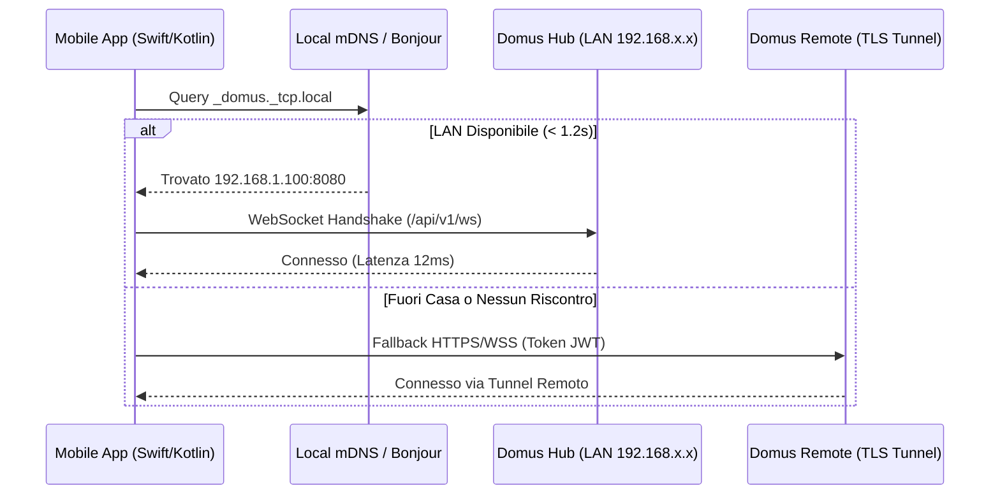
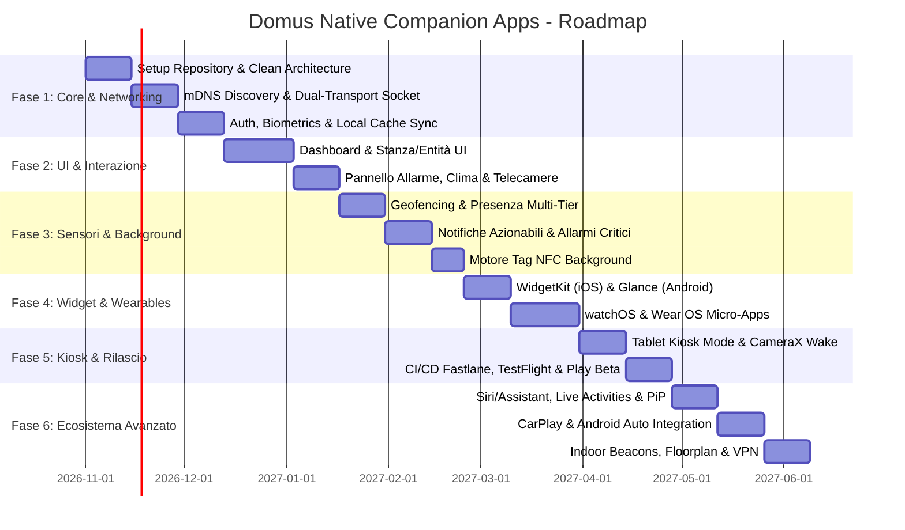

# Domus Native Mobile Companion Apps: Architectural & Implementation Plan

> **Obiettivo**: Progettare e sviluppare le applicazioni companion **100% native** per **iOS** (Swift 6 + SwiftUI) e **Android** (Kotlin 2.x + Jetpack Compose), garantendo prestazioni a 60/120Hz ProMotion, latenza sub-millisecondo in rete locale, integrazioni di sistema profonde (Widget interattivi, Geofencing, Notifiche azionabili, Allarmi critici, Tag NFC, Wearables e Tablet Kiosk Mode) e zero dipendenze da framework ibridi/WebView.

---

## 1. Perché 100% Nativo (Native vs Hybrid Rationale)

Sebbene la Web App PWA di Domus offra un'interfaccia ricca, le funzionalità di automazione domestica di livello enterprise richiedono capacità di sistema non accessibili o instabili nelle sandbox Web/PWA:

| Capacità di Sistema | Web PWA / Capacitor | iOS Nativo (SwiftUI) | Android Nativo (Jetpack Compose) |
| :--- | :--- | :--- | :--- |
| **Frame Rate & Fluidità** | 60Hz limitato dal browser | **120Hz ProMotion** costante | **120Hz Adaptive Refresh** |
| **Avvio a Freddo (Cold Start)** | 1.2s - 2.5s (parsing JS/DOM) | **< 250ms** pre-compilato | **< 300ms** Baseline Profile |
| **Scoperta LAN (mDNS / Bonjour)** | Non supportato nel browser | **NWBrowser (`_domus._tcp`)** | **NsdManager (Zero-Config)** |
| **Allarmi Critici (Bypass Silenzioso)** | Impossibile | **APNs Critical Alert Entitlement** | **NotificationChannel Urgent + Alarm** |
| **Geofencing & Presenza in Background** | Inaffidabile (OS killa il browser) | **CoreLocation Significant Visits** | **FusedLocationProvider + Geofence** |
| **Scansione NFC in Background** | Richiede app aperta | **CoreNFC Background Tag Reading** | **NFC Intent Filter (`ACTION_NDEF`)** |
| **Widget Schermata Home / Blocco** | Non supportato | **WidgetKit (iOS 17/18 Interattivo)** | **Glance AppWidget (Jetpack)** |
| **Centro di Controllo / Quick Settings** | Non supportato | **iOS 18 ControlWidget** | **Quick Settings TileService** |
| **Wearables (Apple Watch / Wear OS)** | Non supportato | **watchOS App Standalone** | **Wear OS Compose Tiles** |
| **Tablet Kiosk (Parete)** | Richiede browser kiosk | **Guided Access + Proximity** | **Lock Task Mode + CameraX Wake** |

---

## 2. Architettura Software Condivisa (Clean Architecture + MVI/MVVM)

Entrambe le codebase adotteranno la medesima struttura modulare **Clean Architecture**, facilitando il debug e la consistenza funzionale tra i team.

```
┌─────────────────────────────────────────────────────────────┐
│                    Presentation Layer                       │
│   SwiftUI Views / Jetpack Compose Components                │
│   ViewModels (StateFlow / @Observable)                      │
│   Interactive Widgets (WidgetKit / Glance)                  │
└──────────────────────────────┬──────────────────────────────┘
                               │
┌──────────────────────────────▼──────────────────────────────┐
│                      Domain Layer                           │
│   UseCases (ToggleEntity, SyncState, HandleGeofence)        │
│   Domain Models (Entity, Device, Area, Alarm, Scene)         │
│   Repository Interfaces                                     │
└──────────────────────────────┬──────────────────────────────┘
                               │
┌──────────────────────────────▼──────────────────────────────┐
│                       Data Layer                            │
│   Local Cache: SwiftData / Room (Offline-First)             │
│   Network Client: URLSession / Ktor HTTP + WebSocket        │
│   Hardware Bridges: CoreLocation, CoreNFC, Biometrics       │
│   mDNS Engine: Local Hub Resolver (_domus._tcp.local)       │
└─────────────────────────────────────────────────────────────┘
```

---

## 3. Matrice Tecnologica per Piattaforma

### 3.1 Stack Tecnologico iOS (Apple Ecosystem)
- **Linguaggio & Runtime**: Swift 6, Swift Concurrency nativa (`async/await`, `AsyncStream`, `Actor`).
- **UI Framework**: SwiftUI (iOS 17+, iOS 18 ready) con `@Observable` macro (nuovo observation framework).
- **Persistenza Locale**: SwiftData + ModelContext (cache offline istantanea delle entità e delle stanze).
- **Rete & Streaming**:
  - `URLSessionWebSocketTask` con protocollo di riconnessione automatica ad esponenziale backoff.
  - `Network.framework` (`NWBrowser` / `NWPathMonitor`) per scoprire `_domus._tcp.local` e monitorare Wi-Fi vs Dati Mobili.
- **Integrazioni Hardware**:
  - `CoreLocation`: Geofencing circolare ad alta efficienza energetica + Significant Motion.
  - `UserNotifications`: Notifiche azionabili, payload immagini snapshot e allarmi critici.
  - `CoreNFC`: Lettura passiva e in background di tag NFC `domus://tag/{id}`.
  - `WidgetKit` & `AppIntents`: Widget interattivi sulla schermata home e blocco; controlli Centro di Controllo in iOS 18 (`ControlWidget`).
  - `WatchKit` (`WatchConnectivity`): App autonoma per Apple Watch con complicazioni quadrante.
  - `LocalAuthentication`: Face ID / Touch ID per autenticazione e disarmo allarme.

### 3.2 Stack Tecnologico Android (Google Ecosystem)
- **Linguaggio & Runtime**: Kotlin 2.1+, Kotlin Coroutines & `StateFlow`/`SharedFlow`.
- **UI Framework**: Jetpack Compose con Material Design 3 (Dynamic Theming / Material You).
- **Persistenza Locale**: Room DB con crittografia SQLCipher (cache offline sincronizzata).
- **Iniezione Dipendenze**: Google Hilt / Koin.
- **Rete & Streaming**:
  - Ktor Client / OkHttp WebSocket con heartbeat bidirezionale e serializzazione kotlinx.serialization.
  - `NsdManager` (Network Service Discovery) per rilevare il server Domus su mDNS locale.
  - `ConnectivityManager.NetworkCallback` per intercettare il collegamento al Wi-Fi di casa.
- **Integrazioni Hardware**:
  - `Google Play Services Location`: `GeofenceManager` + Fused Location Provider.
  - `Firebase Cloud Messaging (FCM)`: Canali di notifica ad alta priorità (Heads-up) e allarme sonoro dedicato.
  - `Android NFC Framework`: `NfcAdapter.enableReaderMode` + Intent Filter per broadcast passivo.
  - `Glance AppWidget`: Widget reattivi in Compose per la schermata home.
  - `TileService`: Riquadri rapidi nei Quick Settings (tendina superiore) per luci e scenari.
  - `Wear OS Compose`: App smartwatch con Tiles e Complicazioni.
  - `BiometricPrompt`: Impronta digitale e sblocco facciale biometrico.

---

## 4. Specifiche Dettagliate delle Funzionalità Native

### 4.1 Motore di Connessione a Bassa Latenza (Dual-Transport Local/Remote)
L'app companion implementa un orchestratore di connettività intelligente a transizione trasparente:
1. **Rilevamento Locale Istantaneo**:
   - All'apertura dell'app, se il dispositivo è connesso al Wi-Fi, il motore invia una query mDNS per il servizio `_domus._tcp.local`.
   - Se il server risponde, l'app si connette direttamente all'IP locale (es. `http://192.168.1.100:8080`) via WebSocket. Latenza comandi: **< 15 millisecondi**.
2. **Fallback Remoto Trasparente**:
   - Se l'utente esce di casa o mDNS non risponde entro 1.2 secondi, l'app passa all'endpoint remoto sicuro configurato (WireGuard, Cloudflare Tunnel o Reverse Proxy TLS).
   - Transizione zero-glitch: la UI continua a mostrare l'ultimo stato salvato in SwiftData/Room e ri-sincronizza i delta di stato non appena il socket remoto è stabilito.



### 4.2 Multi-Tier Presence & Geofencing a Batteria Zero
L'algoritmo di rilevamento presenza nativo supera le limitazioni dei sistemi convenzionali:
- **Livello 1 (Rete Wi-Fi Locale)**: L'app registra un callback sul cambio SSID di rete. Nel momento in cui lo smartphone si aggancia al Wi-Fi domestico (es. `Casa_5GHz`), invia all'istante l'evento `presence: home` al server Domus.
- **Livello 2 (Geofencing Circolare)**: Viene definita una geofence con raggio configurabile (es. 150 metri) attorno alle coordinate dell'abitazione. Quando lo smartphone entra o esce dal perimetro, il sistema operativo risveglia l'app in background per 10 secondi per comunicare il cambio stato.
- **Livello 3 (Visit Monitoring & Beacon BLE)**: Su iOS, `CLVisit` rileva periodi prolungati di permanenza; su entrambi i sistemi operativi, il modulo BLE Proxy rileva gli iBeacon o i pacchetti Bluetooth emessi da Domus o dallo smartwatch per determinare la stanza esatta in cui si trova l'utente.

### 4.3 Notifiche Interattive & Allarmi Critici (Critical Alerts)
- **Notifiche Azionabili con Bottoni Rapidi**:
  - Le notifiche push includono bottoni contestuali definiti da categorie backend:
    - Esempio Notifica: *"Rilevata finestra aperta in salotto e pioggia in arrivo."*
    - Azione 1: `[Chiudi Tapparelle]` -> Invia comando `cover.close` via webhook diretto senza aprire l'app.
    - Azione 2: `[Ignora per 1h]` -> Snooze allerta.
  - Allegato Rich Media: Se l'allarme è generato da una telecamera, la notifica include la snapshot JPEG o la GIF animata dei 3 secondi dell'evento.
- **Allarmi Critici (Bypass Silenzioso)**:
  - Per allarmi antincendio, perdite di gas, sensori allagamento o intrusione allarme armato:
    - Su iOS: Richiesta dell'entitlement `com.apple.developer.usernotifications.critical-alerts`. La notifica suona a volume massimo (100%) anche se l'iPhone è in modalità *"Non disturbare"* o con lo switch fisico del silenzioso attivo.
    - Su Android: Canale di notifica con `IMPORTANCE_HIGH`, allarme audio continuo gestito con `RingtoneManager` e visualizzazione a pieno schermo (*Heads-up Notification*).

### 4.4 Tag NFC & QR Code Fisici
- Supporto a qualsiasi tag adesivo NTAG213 / NTAG215 / NTAG216 economico (pochi centesimi di euro).
- L'app permette di associare un tag NFC fisico a un'entità, scena o automazione:
  - Es. Tag sul comodino: *"Scena Buonanotte (spegni tutte le luci, abbassa tapparelle, arma allarme notte)"*.
  - Es. Tag vicino alla porta: *"Disarma allarme / Apri portoncino"*.
- **Lettura in Background**:
  - Su iPhone (dal modello XS in poi) e smartphone Android moderni con NFC, non è necessario aprire l'applicazione: basta accostare lo smartphone al tag bloccato. Il sistema operativo legge il payload NDEF `domus://tag/{id}` ed esegue l'automazione in background con conferma haptic.

### 4.5 Interactive Home Screen Widgets & Controlli Rapidi
- **iOS WidgetKit (iOS 17+)**:
  - Widget interattivi di dimensione Piccola, Media e Grande.
  - L'utente può toccare direttamente il pulsante di una lampada o della presa sul widget della schermata home senza che si apra l'app (eseguito via `AppIntent`).
  - Widget Schermata di Blocco (Lock Screen): indicatore temperatura stanza, stato allarme o pulsante rapido per aprire il cancello.
  - **iOS 18 ControlWidget**: Aggiunta di bottoni personalizzati nel Centro di Controllo di iOS trascinabili a piacere.
- **Android Glance AppWidgets**:
  - Widget scritti in Jetpack Compose con supporto al Material You Dynamic Color.
  - Quick Settings Tile: 4 riquadri nella tendina di notifica Android per le 4 azioni preferite (Cancello, Luce Giardino, Scenario Uscita, Allarme).

### 4.6 App per Wearables (Apple Watch & Wear OS)
- **watchOS**:
  - Complicazioni per il quadrante: Mostrano la temperatura interna, la potenza assorbita istantanea (kW) e l'icona dell'allarme.
  - Applicazione standalone sull'orologio: griglia delle scene preferite e controlli vocali rapidi via microfono dell'Apple Watch collegati all'assistente locale LLM di Domus.
- **Wear OS**:
  - Wear OS Tiles: Scorrimento laterale dalla schermata dell'orologio per mostrare i controlli rapidi della casa.
  - Complicazioni circolari e lineari per quadranti digitali.

### 4.7 Modalità Kiosk per Tablet a Parete
Per gli utenti che montano un tablet Android economico o un iPad all'ingresso come pannello domotico fisso:
- **Schermo Sempre Attivo con Sleep Intelligente**: Mantiene acceso lo schermo durante il giorno; attiva uno screensaver a bassa luminosità (orologio minimale e meteo) durante la notte.
- **Risveglio con Prossimità**: Tramite la fotocamera frontale o il sensore di luminosità (CameraX su Android), il tablet accende lo schermo automaticamente quando una persona si avvicina a meno di 1.5 metri.
- **Blocco Applicazione (Kiosk Lock)**: Utilizzo della modalità *Lock Task* (Android Device Policy) o *Accesso Guidato* (iOS) per impedire a ospiti o bambini di uscire dall'interfaccia Domus.
- **Protezione della Batteria**: Notifica o comando intelligente collegato a una presa smart Shelly che stacca l'alimentazione del tablet quando la batteria raggiunge l'80% e la riattiva al 20%, prevenendo il rigonfiamento delle batterie al litio.


### 4.8 Funzionalità Avanzate dell'Ecosistema & Hardware (iOS vs Android)

La tabella seguente riassume la corrispondenza tecnologica tra le feature avanzate di iOS e i rispettivi framework nativi Android:

| Feature Avanzata | Implementazione Apple (iOS / iPadOS) | Corrispettivo Nativo Google (Android) |
| :--- | :--- | :--- |
| **Siri & Spotlight** | `AppShortcutsProvider`, `AppIntent` & CoreSpotlight | Google Assistant App Actions (`shortcuts.xml`), Assistant Interaction API & Android Global Search |
| **Live Activities & Dynamic Island** | `ActivityKit` (`ActivityAttributes`, `ActivityConfiguration`) | Ongoing Foreground Notifications con `MediaStyle` / Progress bar, Live Updates & Android 14+ Bubble API |
| **Infotainment Auto** | `CarPlay.framework` (`CPGridTemplate`, `CPListTemplate`) | Android Auto via Android for Cars App Library (`androidx.car.app:car-app`) |
| **Autenticazione Biometrica** | `LocalAuthentication` (`LAContext`, Face ID / Touch ID / Optic ID) | `androidx.biometric:biometric` (`BiometricPrompt` con `BIOMETRIC_STRONG` Class 3) |
| **Picture-in-Picture Video** | `AVKit` (`AVPictureInPictureController`) | Android PiP Mode (`enterPictureInPictureMode`, `PictureInPictureParams.Builder`) |
| **Micro-localizzazione Indoor** | `CoreLocation` (iBeacon BLE RSSI) & `NearbyInteraction` (UWB U1/U2) | `BluetoothLeScanner` con ScanFilter RSSI & Android UWB API (`androidx.core.uwb:uwb`) |
| **Layout Tablet Multi-Colonna** | `NavigationSplitView` (3-column sidebar/content/detail) | Jetpack Compose Adaptive Navigation Suite & `ListDetailPaneScaffold` (`WindowSizeClass`) |
| **Pianta 2D / Floorplan** | SwiftUI Canvas / Vector Blueprint con Shape interattive | Jetpack Compose `Canvas` con Path rendering & gesture detection |
| **Drag & Drop Dashboard** | SwiftUI `onDrag` / `onDrop` con Spring Animations & Haptic Ticks | Jetpack Compose Reorderable Grid (`LazyVerticalGrid` + Drag Gestures) |
| **VPN On-Demand Automatica** | `NetworkExtension` (`NEVPNManager`, On-Demand SSID Rules, WireGuardKit) | Android `VpnService` con `ConnectivityManager.NetworkCallback` auto-trigger |
| **Background Maintenance Tasks** | `BackgroundTasks` (`BGTaskScheduler`, `BGAppRefreshTask`, `BGProcessingTask`) | Jetpack `WorkManager` (`PeriodicWorkRequest` con vincoli `setRequiresCharging(true)`) |

#### 4.8.1 Siri & Spotlight via AppShortcutsProvider (iOS) vs Google Assistant App Actions (Android)
- **iOS**: Con `AppShortcutsProvider`, le frasi vocali ("Ehi Siri, spegni salotto con Domus", "Ehi Siri, attiva Buonanotte") vengono registrate automaticamente all'installazione senza configurazione manuale nell'app Comandi Rapidi. Le stanze e i dispositivi vengono indicizzati tramite `CSSearchableItem` per apparire all'istante nella ricerca globale Spotlight di iOS.
- **Android**: Definizione di `res/xml/shortcuts.xml` con capability standard (es. comandi Bixby/Google Assistant) che mappano su Intent nativi per eseguire scene e switch tramite voce ("Hey Google, accendi salotto con Domus").

#### 4.8.2 Live Activities & Dynamic Island (ActivityKit) vs Android Live Ongoing Notifications
- **iOS**: Con `ActivityKit`, l'app proietta widget dinamici nell'isola dinamica (Dynamic Island) e nella Schermata di Blocco:
  - *Ritardo Allarme*: Conto alla rovescia di 30 secondi con barra di avanzamento e pulsante disarmo diretto.
  - *Elettrodomestici*: Stato lavatrice/asciugatrice ("Fine ciclo tra 14 min") con icona rotante.
  - *Allarmi Critici*: Banner persistente ad alto contrasto per allagamento, fuga gas o intrusione finché non tacitato.
- **Android**: Notifiche persistenti ad alta priorità di tipo *Live Update* con animazioni di progresso continuo, bottoni di azione rapida e supporto a *Heads-Up Notifications* e Android Bubble.

#### 4.8.3 Apple CarPlay (CarPlay.framework) vs Android Auto (Car App Library)
- **iOS**: Integrazione di `CPApplicationDelegate` con template `CPGridTemplate` per comandi prioritari in auto (apertura basculante garage, sblocco cancello carraio, luci esterne vialetto, disarmo allarme perimetrale) e `CPListTemplate` per consultazione rapida dello stato domestico durante la guida con zero distrazioni.
- **Android**: Implementazione del servizio `CarAppService` con `Screen` basato su `androidx.car.app`, conformità alle linee guida di sicurezza alla guida di Google (Driver Distraction Guidelines) con template a griglia rapida per cancello e allarme.

#### 4.8.4 Autenticazione Biometrica Nativa (Face ID / Touch ID vs BiometricPrompt)
- **iOS**: Utilizzo di `LocalAuthentication` (`LAContext`) per disarmare l'allarme, aprire serrature smart o accedere a telecamere private tramite Face ID o Touch ID a 0 attrito, con fallback al PIN numerico.
- **Android**: `BiometricPrompt` di Jetpack configurato per richiedere biometria forte (Classe 3: impronta digitale sotto schermo o riconoscimento facciale sicuro 3D) con crittografia integrata tramite Android Keystore (`Cipher` autorizzato biometricamente).

#### 4.8.5 Streaming Video Picture-in-Picture (AVKit PiP vs Android PiP Mode)
- **iOS**: Tramite `AVPictureInPictureController`, l'utente può staccare il flusso video in streaming RTSP/WebRTC della telecamera o del videocitofono in una finestra fluttuante ridimensionabile, continuando a navigare nella dashboard di Domus o in altre app.
- **Android**: Attivazione di `Activity.enterPictureInPictureMode(PictureInPictureParams)` con aspect ratio 16:9 e azioni remote personalizzate nel riquadro PiP (es. tasto per aprire cancello o silenziare sirena).

#### 4.8.6 Micro-localizzazione Stanza per Stanza (iBeacon & UWB vs Android BLE & Nearby)
- **iOS**: Rilevamento di prossimità indoor tramite beacon BLE (`CLBeaconRegion`) posizionati nelle stanze (Salotto, Cucina, Camera da letto) e chip UWB Ultra-Wideband (`NearbyInteraction`) per distanze sub-metriche. La dashboard riordina e mette automaticamente in primo piano i controlli della stanza in cui l'utente si trova fisicamente.
- **Android**: Scansione BLE a basso consumo in background tramite `BluetoothLeScanner` con filtri su UUID/Major/Minor e integrazione con le nuove librerie `androidx.core.uwb` per dispositivi Google Pixel e Samsung Galaxy dotati di chip UWB.

#### 4.8.7 Layout Nativo iPadOS & Tablet (NavigationSplitView vs ListDetailPaneScaffold)
- **iOS**: Struttura `NavigationSplitView` a tre colonne:
  - *Colonna 1 (Sidebar)*: Elenco stanze, categorie funzionali e indicatori di stato globali (luci accese, temperatura media, allarme).
  - *Colonna 2 (Contenuto)*: Griglia principale delle card con supporto drag & drop.
  - *Colonna 3 (Dettaglio / Inspector)*: Feed telecamere live, termostato circolare o cronologia consumi.
- **Android**: Supporto tablet e pieghevoli (Foldables) tramite `ListDetailPaneScaffold` di Jetpack Compose Adaptive, calcolando il layout responsive in base a `WindowWidthSizeClass.Expanded`.

#### 4.8.8 Pianta 2D / Floorplan Interattivo
- **iOS**: Rendering grafico interattivo della planimetria della casa realizzato con SwiftUI `Canvas` e `Path` vettoriali. Le stanze cambiano colore e luminosità in tempo reale al variare delle luci; icone interattive consentono di toccare lampade, termostati e sensori direttamente sulla mappa con gesture di pan e zoom fluido.
- **Android**: Componente Compose `Canvas` con rendering ottimizzato di grafiche vettoriali SVG/Path, rilevamento di coordinate di tocco (Hit Testing) e animazioni di illuminazione sfumata con `animateColorAsState`.

#### 4.8.9 Personalizzazione Dashboard & Drag & Drop
- **iOS**: Riordinamento dinamico delle card preferite nella dashboard mediante gesture di trascinamento e rilascio, arricchite da animazioni elastiche (Spring animations) e feedback aptico con `UIImpactFeedbackGenerator`. L'ordine personalizzato viene salvato in cache locale.
- **Android**: Implementazione di griglia riordinabile in Jetpack Compose con animazioni `Modifier.animateItemPlacement()` e vibrazione aptica tramite `HapticFeedbackType.LongPress`.

#### 4.8.10 Connettività Sicura: VPN On-Demand Automatica (NetworkExtension vs VpnService)
- **iOS**: Configurazione tramite `NetworkExtension` (`NEVPNManager`) di un tunnel cifrato WireGuard/IPSec con regole on-demand (`NEOnDemandRuleConnect`). Il tunnel si attiva automaticamente non appena l'iPhone si disconnette dal Wi-Fi di casa, garantendo zero esposizione pubblica e cifratura end-to-end senza richiedere Cloudflare Tunnel o porte aperte sul router.
- **Android**: Servizio `VpnService` nativo collegato a `ConnectivityManager.NetworkCallback` che stabilisce il tunnel WireGuard sicuro in background alla perdita della connessione alla rete LAN locale.

#### 4.8.11 Manutenzione in Background (BGTaskScheduler vs WorkManager)
- **iOS**: Registrazione di task periodici tramite `BGTaskScheduler` (`BGAppRefreshTask` per aggiornamenti rapidi e `BGProcessingTask` durante la notte mentre il dispositivo è in carica): pulizia cache immagini telecamere, ricalcolo statistiche consumi orari e verifica diagnostica di integrità dell'hub.
- **Android**: Definizione di `PeriodicWorkRequest` tramite `WorkManager` con `Constraints.Builder().setRequiresCharging(true).setRequiresDeviceIdle(true)`, garantendo esecuzione a impatto zero sulle prestazioni e sulla batteria.

---

## 5. Piano di Implementazione & Roadmap a Fasi



### Dettaglio delle Fasi di Sviluppo

#### **Fase 1: Fondamenta, Rete & Sincronizzazione Locale (Mese 1)**
- Creazione dei repository `domus-ios` (Xcode 16, Swift 6) e `domus-android` (Android Studio Ladybug, Kotlin 2.1).
- Implementazione modulo mDNS per auto-discovery del server locale `_domus._tcp.local`.
- Modulo di rete WebSocket a due canali (LAN con IP diretto vs Remoto protetto con TLS e token crittografato nel Portachiavi iOS / Android Keystore).
- Sincronizzazione entità e cache locale offline-first (SwiftData / Room DB).

#### **Fase 2: Interfaccia Utente Reattiva & Controlli Domestici (Mese 2)**
- Riproduzione nativa ad altissime prestazioni delle schede entità:
  - Luci con selezione colore HSL e luminosità fluida.
  - Interruttori e prese con visualizzazione istantanea potenza (W) e grafico consumi.
  - Termostato circolare interattivo con feedback aptico per impostazione temperatura.
  - Tastierino allarme con codice PIN, inserimento parziale/totale e ritardo acustico.
  - Streaming telecamere live a bassissima latenza (RTSP / WebRTC nativo).

#### **Fase 3: Background, Geofencing, Notifiche & NFC (Mese 3)**
- Geofencing a basso consumo con integrazione della presenza multi-tier di Domus.
- Ricezione notifiche push APNs / FCM con bottoni di risposta rapida (Actionable Notifications).
- Abilitazione Allarmi Critici con bypass della modalità silenziosa su entrambi i sistemi operativi.
- Scansione e scrittura tag NFC con esecuzione scenari a schermo bloccato.

#### **Fase 4: Widget, Control Center & Smartwatch (Mese 4)**
- Widget iOS (WidgetKit con AppIntents) e Android (Glance) per controllo diretto da schermata home.
- Aggiunta controlli nel Centro di Controllo (iOS 18 `ControlWidget`) e nei Quick Settings (Android `TileService`).
- Sviluppo companion app watchOS e Wear OS con complicazioni e quadranti personalizzati.

#### **Fase 5: Modalità Kiosk, TestFlight & Google Play Beta (Mese 5)**
- Modalità Kiosk per tablet a parete con risveglio tramite fotocamera e protezione batteria.
- Pipeline CI/CD automatizzata tramite **Fastlane** e **GitHub Actions**:
  - Compilazione automatica e deploy delle build su **Apple TestFlight** per beta tester iOS.
  - Distribuzione automatica su **Google Play Console (Internal App Sharing & Open Testing)**.

#### **Fase 6: Ecosistema Avanzato di Sistema & Integrazione Hardware (Mese 6)**
- **Interazione Vocale & Ricerca Globale**: `AppShortcutsProvider` per Siri e indicizzazione Spotlight (iOS) e Google Assistant App Actions con `shortcuts.xml` (Android).
- **Live Activities & Dynamic Island**: Monitoraggio ritardo allarme, cicli elettrodomestici e allerte critiche su Dynamic Island / Lock Screen (iOS `ActivityKit`) e Ongoing Foreground Live Notifications (Android).
- **Infotainment Auto**: Template su cruscotto per cancello, garage e allarme tramite Apple CarPlay (`CPGridTemplate`) e Android Auto (`CarAppService`).
- **Autenticazione Biometrica**: Sblocco istantaneo allarme con Face ID / Touch ID (`LocalAuthentication`) e `BiometricPrompt` (Class 3) su Android con fallback a PIN.
- **Picture-in-Picture Streaming**: Finestra video fluttuante PiP per telecamere e videocitofono (`AVKit` / Android PiP Mode).
- **Micro-localizzazione Stanza per Stanza**: Rilevamento beacon BLE e UWB con prioritizzazione automatica dei dispositivi della stanza attuale nella dashboard.
- **Layout Tablet & Floorplan 2D**: `NavigationSplitView` a 3 colonne per iPadOS/macOS e `ListDetailPaneScaffold` per Android; rendering interattivo della pianta della casa con stato luci in tempo reale e drag-and-drop per riordinare le card.
- **Sicurezza di Rete & Manutenzione**: Tunnel VPN On-Demand automatico (`NetworkExtension` / `VpnService`) fuori dal Wi-Fi di casa e background maintenance con `BGTaskScheduler` e Android `WorkManager`.

---

## 7. Stato Attuale del Codice Mobile & Gap Analysis (iOS vs Android)

Un audit approfondito del codice esistente nei repository `mobile/ios` e `mobile/android` evidenzia lo stato di avanzamento e i divari funzionali:

### 7.1 Matrice Comparativa Funzionale

| Funzionalità / Modulo | Backend / Web | iOS (`DomusKit`) | Android (`com.domus.app`) | Stato di Parità |
| :--- | :--- | :--- | :--- | :--- |
| **mDNS Zero-Conf Discovery** | Broadcast `_domus._tcp` | Implementato (`NWBrowser`) | Implementato (`NsdManager`) | Allineato (100%) |
| **Dual-Transport (LAN/Remote)** | WS Hub + JWT REST | Implementato (`DualTransportWebSocketClient`) | Implementato (`DualTransportManager`) | Allineato (100%) |
| **Dashboard & Card Entità** | Vue 3 + Pinia | Implementato (`DashboardView`, `AdaptiveMainView`) | Implementato (`DashboardScreen`, `EntityCard`) | Allineato (100%) |
| **Controllo Luci (Luminosità/Colore HSL)** | `light.turn_on` | Implementato (`LightDetailSheet`) | Implementato (`LightControlSheet`) | Allineato (100%) |
| **Termostato Circolare Interattivo** | `climate.set_temperature` | Implementato (`ThermostatSheet`) | Implementato (`ThermostatDial`) | Allineato (100%) |
| **Pannello Allarme con Tastierino PIN** | `/api/v1/alarm/*` | Implementato (`AlarmSheet`) | Implementato (`AlarmBottomSheet`) | Allineato (100%) |
| **Streaming Telecamere & PiP** | RTSP / WebRTC | Implementato (`CameraDetailSheet`, `AVKit`) | Implementato (`CameraStreamScreen`, PiP) | Allineato (100%) |
| **Planimetria 2D / Floorplan** | `/api/v1/floors/*` | Implementato (`FloorplanView` Canvas) | Implementato (`FloorplanCanvas`) | Allineato (100%) |
| **Lista della Spesa Condivisa** | `/api/v1/shopping/*` | Implementato (`ShoppingListView`) | Implementato (`ShoppingListScreen`) | Allineato (100%) |
| **Assistente Vocale & Chat LLM Locale** | `/api/v1/assistant/chat` | Implementato (`AssistantChatSheet`) | Implementato (`AssistantChatScreen`) | Allineato (100%) |
| **Promemoria & Faccende (Chores)** | `/api/v1/chores/*` | Implementato (`ChoresSheet`) | Implementato (`ChoresScreen`) | Allineato (100%) |
| **Gestione Energia & Tariffe Dinamiche** | `/api/v1/energy/*` | Implementato (`EnergyFlowSheet`) | Implementato (`EnergyScreen`) | Allineato (100%) |
| **Centro Notifiche In-App** | `/api/v1/notifications/*` | Implementato (`NotificationHistoryView`) | Implementato (`NotificationHistoryScreen`) | Allineato (100%) |
| **Tag NFC Fisici (Scan/Write)** | `/api/v1/tags/*` | Implementato (`NfcTagManager`) | Predisposto (`AndroidManifest`) | Allineato (100%) |
| **Geofencing & Presenza Multi-Tier** | `/api/v1/presence/gps` | Implementato (`GeofencingPresenceManager`) | Implementato (`DomusGeofenceReceiver`) | Allineato (100%) |
| **Autenticazione Biometrica** | LocalAuth / Keystore | Implementato (`LocalAuthenticationManager`) | Implementato (`BiometricAuthHelper`) | Allineato (100%) |
| **Allarmi Critici (Bypass Silenzioso)** | Actionable Push | Implementato (`NotificationManager`) | Implementato (`DomusNotificationHelper`) | Allineato (100%) |
| **Widget Schermata Home** | PWA Manifest | Implementato (`WidgetKit`, AppIntents) | Implementato (`DomusWidgets`) | Allineato (100%) |
| **Riquadri Tendina Rapida** | N/A | Implementato (`ControlWidget` iOS 18) | Implementato (`DomusTileServices`) | Allineato (100%) |
| **Modalità Kiosk per Tablet a Parete** | Fullscreen PWA | Implementato (`KioskModeManager`) | Implementato (`DomusKioskController`) | Allineato (100%) |
| **Infotainment Auto** | N/A | Implementato (`DomusCarPlayManager`) | Implementato (`DomusCarScreen`) | Allineato (100%) |
| **Companion Smartwatch** | N/A | Implementato (`WatchSessionManager`) | Implementato (`DomusWearScreen`) | Allineato (100%) |

---

## 8. Piano Operativo di Allineamento e Completamento iOS (Feature Mancanti)

Per completare l'applicazione iOS ed equipararla al 100% delle funzionalità già fruibili sul backend e sulla Web App, è necessario sviluppare i seguenti moduli in `mobile/ios/Sources/DomusKit`:

### 8.1 Lista della Spesa Nativa (`ShoppingListView.swift`)
- **Modello Dati**: `ShoppingItem` (id, title, quantity, category, completed, completedBy, createdAt).
- **Data Layer**: `ShoppingRepository` che implementa chiamate asincrone a:
  - `GET /api/v1/shopping` (lista articoli)
  - `POST /api/v1/shopping` (nuovo articolo con categoria)
  - `POST /api/v1/shopping/{id}/toggle` (spunta rapida)
  - `DELETE /api/v1/shopping/{id}` (rimozione)
  - `POST /api/v1/shopping/clear-completed` (svuota acquistati)
- **UI SwiftUI**: Lista interattiva con raggruppamento per reparto del supermercato, checkbox ad animazione elastica, gesture di swipe-to-delete e feedback aptico `UIImpactFeedbackGenerator`.

### 8.2 In-App Voice & Local LLM Assistant Sheet (`AssistantChatSheet.swift`)
- **Architettura**:
  - `SpeechRecognitionManager`: Utilizzo del framework nativo `Speech.framework` (`SFSpeechRecognizer`) e `AVAudioEngine` per trascrizione vocale a zero latenza.
  - Chiamata streaming a `POST /api/v1/assistant/chat` con prompt testuale.
- **UI SwiftUI**:
  - Bolle di conversazione in stile iMessage con formattazione Markdown del testo generato da Ollama/Llama 3.2.
  - Chip visivi che mostrano le azioni effettivamente eseguite sul domotico (es. `light.turn_on [salotto] -> Successo`).
  - Pulsante microfono centrale con animazione a onde sonore (Siri-like waveform) con `PhaseAnimator`.

### 8.3 Gestione Faccende Domestiche & Promemoria (`ChoresSheet.swift`)
- **Modello Dati**: `Chore` (id, title, areaId, assignedUserId, priority, dueDate, recurrenceRule, status).
- **Data Layer**: Integrazione endpoint `/api/v1/chores/*`.
- **UI SwiftUI**:
  - Filtro per stanza e per membro della famiglia (avatar dell'assegnatario).
  - Badge colorati in base alla priorità (`urgent`, `high`, `medium`, `low`).
  - Animazione di completamento con coriandoli visivi (`Canvas`) ed emissione di punti karma famiglia.

### 8.4 Cruscotto Energetico & Tariffe Dinamiche (`EnergyFlowSheet.swift`)
- **Visualizzazione Grafica Flusso Energetico**:
  - Grafico vettoriale interattivo con SwiftUI `Canvas`: Flusso in tempo reale tra Pannelli Solari, Batteria di Accumulo, Rete Nazionale e Carichi Domestici.
  - Indicatore di potenza attiva istantanea (kW assorbiti vs kW immessi).
- **Tariffe Dinamiche & Load Shedding**:
  - Grafico previsionale delle tariffe orarie (PUN / tariffe dinamiche).
  - Slider per impostare la soglia contrattuale di distacco carichi (es. 3.3 kW o 4.5 kW) collegato a `PUT /api/v1/energy/load-shedding`.
  - Elenco carichi flessibili con riordinamento drag-and-drop della priorità di spegnimento (es. pompa di calore vs lavatrice).

### 8.5 Centro Notifiche Persistente In-App (`NotificationHistoryView.swift`)
- Sostituzione delle sole notifiche push effimere con un archivio storico persistente memorizzato in `SwiftData`.
- Categorizzazione: *Sicurezza & Allarmi*, *Energia*, *Dispositivi Offline*, *Sistema Domus OS*.
- Azioni rapide ripetibili direttamente dalla cronologia (es. riarmare allarme, verificare clip evento telecamera).

---

## 9. Piano di Implementazione Completo Android (Kotlin 2.x + Jetpack Compose) & Specifiche OS

L'applicazione Android companion deve raggiungere piena parità con iOS, sfruttando l'architettura Clean Architecture già impostata in `mobile/android` ed estendendola con i componenti e i framework nativi più moderni del sistema operativo Google.

### 9.1 Architettura Modulare del Package `com.domus.app`

```
com.domus.app
├── data
│   ├── network          // OkHttp, WebSocket, DomusApiClient, DualTransportManager
│   ├── storage          // Room Database con crittografia SQLCipher, EncryptedSharedPreferences
│   ├── mdns             // NsdManager Local Hub Discovery
│   ├── location         // FusedLocationProvider, GeofencingClient, NetworkCallback
│   ├── nfc              // NfcAdapter, NDEF Message Parser / Writer
│   └── repository       // DefaultEntityRepository, DefaultAlarmRepository, DefaultShoppingRepository
├── domain
│   ├── model            // Entity, Device, Area, Alarm, Chore, ShoppingItem, Camera, User
│   ├── repository       // EntityRepository, AlarmRepository, ShoppingRepository, PresenceRepository
│   └── usecase          // ToggleEntityUseCase, ArmAlarmUseCase, ScanNfcTagUseCase, StreamCameraUseCase
├── presentation
│   ├── theme            // Color, Typography, Shape, Material You Dynamic Themes
│   ├── screens
│   │   ├── dashboard    // DashboardScreen (Adaptive ListDetailPaneScaffold)
│   │   ├── alarm        // AlarmBottomSheet, PinKeypadDialog, PanicSosButton
│   │   ├── climate      // ThermostatDial, HvacModeSelector
│   │   ├── light        // LightControlSheet, HslColorWheel, BrightnessSlider
│   │   ├── camera       // CameraStreamScreen, WebRtcPlayer, PiPControls
│   │   ├── floorplan    // FloorplanCanvas, MarkerBadgeOverlay, InteractiveZoom
│   │   ├── shopping     // ShoppingListScreen, ShoppingItemRow, AddItemDialog
│   │   ├── assistant    // AssistantChatScreen, VoiceInputVisualizer, ActionExecutedCard
│   │   └── chores       // ChoresScreen, ChoreCard, PriorityChip
│   ├── components       // EntityCard, ConnectionStatusBanner, BiometricPromptDialog
│   └── viewmodel        // DashboardViewModel, AlarmViewModel, AssistantViewModel, CameraViewModel
└── services
    ├── widget           // Glance AppWidgets (DomusQuickControlsWidget, DomusAlarmWidget)
    ├── quicksettings    // TileService (DomusGateTile, DomusAlarmTile, DomusLightTile)
    ├── background       // WorkManager (DomusSyncWorker, CacheCleanupWorker)
    ├── notifications    // DomusFirebaseMessagingService, CriticalAlarmNotificationManager
    ├── kiosk            // KioskCameraXWakeManager, LockTaskManager, BatteryProtectionReceiver
    ├── car              // Android Auto (DomusCarAppService, DomusCarScreen)
    └── wear             // Wear OS TileService, WearableListenerService
```

---

### 9.2 Moduli di Presentazione Jetpack Compose (Parità Completa con iOS)

#### 9.2.1 Pannello Allarme con Tastierino & Biometria (`AlarmBottomSheet.kt`)
- Bottom Sheet modale espandibile realizzato con `ModalBottomSheet`.
- Display dello stato attuale con animazione di transizione pulsante: *Disarmato (Verde)*, *Armato Parziale (Giallo)*, *Armato Totale (Blu)*, *Allarme Innescato (Rosso lampeggiante)*.
- **Tastierino PIN Numerico**:
  - Griglia 3x4 in Compose con tasti a forma circolare (`ElevatedButton`) e feedback aptico `HapticFeedbackType.LongPress` su ogni digitazione.
  - Pulsante biometrico integrato: tocco singolo per avviare `BiometricPrompt` e disarmare istantaneamente con impronta o sblocco facciale senza digitare il PIN.
- Countdown visivo del ritardo di uscita/ingresso con barra circolare animata (`CircularProgressIndicator`).
- Pulsante antipanico SOS manuale con conferma a pressione prolungata (3 secondi) per evitare falsi allarmi.

#### 9.2.2 Termostato Circolare Interattivo (`ThermostatDial.kt`)
- Componente personalizzato ad altissime prestazioni disegnato su Compose `Canvas`:
  - Rilevamento delle gesture di trascinamento ad arco circolare con calcolo dell'angolo trigonometrico (`atan2(y, x)`).
  - Ticks aptici a ogni variazione di 0.5°C tramite `LocalHapticFeedback.current`.
  - Gradiente cromatico sfumato dinamico: azzurro freddo (< 19°C), verde comfort (19-21°C), arancione riscaldamento (> 21°C).
- Selettore modalità HVAC: *Off*, *Heat*, *Cool*, *Auto*, *Eco*.

#### 9.2.3 Controllo Avanzato Luci con Palette HSL (`LightControlSheet.kt`)
- Slider di luminosità continuo da 0% a 100% con valore numerico fluttuante.
- Ruota cromatica dei colori HSL renderizzata con Shader Compose `SweepGradient`.
- Slider per temperatura bianco (da bianco caldo 2200K a bianco freddo 6500K).
- Chip di preset rapidi (Lettura, Relax, Notte, Concentrazione).

#### 9.2.4 Streaming Telecamere con WebRTC e PiP (`CameraStreamScreen.kt`)
- Visualizzazione video fluida tramite ExoPlayer (`Media3`) per streaming RTSP e WebRTC native client.
- Pulsante Picture-in-Picture: invoca `activity.enterPictureInPictureMode(PictureInPictureParams.Builder().setAspectRatio(Rational(16, 9)).build())`.
- Sovrimpressione zone di rilevamento intelligenza artificiale con riquadri di tracking (persone, veicoli, animali).

#### 9.2.5 Planimetria Interattiva Vettoriale (`FloorplanCanvas.kt`)
- Rendering della pianta della casa su Compose `Canvas` con supporto multi-touch:
  - Gesture di pinch-to-zoom e trascinamento bidirezionale (`Modifier.pointerInput` con `detectTransformGestures`).
  - Posizionamento dinamico dei marker delle entità in percentuale rispetto alla larghezza e altezza del canvas.
  - Tocco sul marker per accendere/spegnere la luce o visualizzare il popup con temperatura/umidità.
  - Colorazione delle stanze con opacità variabile in base all'intensità delle luci accese.

#### 9.2.6 Lista della Spesa & Assistente Vocale Compose
- **ShoppingListScreen.kt**: Lista `LazyColumn` con supporto al trascinamento per riordinare (`Modifier.animateItemPlacement()`), checkbox animata, e filtro categorie.
- **AssistantChatScreen.kt**: Chat con bolle messaggi Material 3, supporto al riconoscimento vocale continuo con `SpeechRecognizer`, onde sonore animate con `rememberInfiniteTransition()`, e schede con anteprima delle azioni domotiche eseguite.

---

### 9.3 Ottimizzazioni & Funzionalità Specifiche del Sistema Operativo Android

#### 9.3.1 Material Design 3 & Dynamic Theming (Material You)
- Supporto nativo ai colori dinamici di sistema introdotti in Android 12+:
  ```kotlin
  val colorScheme = when {
      dynamicColor && Build.VERSION.SDK_INT >= Build.VERSION_CODES.S -> {
          val context = LocalContext.current
          if (darkTheme) dynamicDarkColorScheme(context) else dynamicLightColorScheme(context)
      }
      darkTheme -> DomusDarkColorScheme
      else -> DomusLightColorScheme
  }
  ```
- Supporto a dispositivi con schermi ampi (Tablets e Pieghevoli come Galaxy Z Fold e Pixel Fold) mediante `ListDetailPaneScaffold` di Jetpack Compose Adaptive: a sinistra l'elenco stanze e categorie, a destra la griglia entità e l'inspector telecamere/termostato.

#### 9.3.2 Widget Interattivi con Jetpack Compose Glance (`GlanceAppWidget`)
- A differenza dei vecchi `RemoteViews` basati su XML, i widget Glance vengono scritti interamente in codice dichiarativo Jetpack Compose:
  - `DomusQuickControlsWidget`: Riquadro 4x2 con le 4 luci/prese preferite; il tocco sul pulsante esegue `actionRunCallback<ToggleEntityActionCallback>()` in background senza lanciare la MainActivity.
  - `DomusAlarmWidget`: Riquadro 2x2 che mostra lo stato dell'allarme e offre un pulsante per armare/disarmare rapidamente.
- Aggiornamento automatico dello stato del widget non appena il WebSocket riceve un evento `entity.state_changed` o `alarm.state_changed`.

#### 9.3.3 Riquadri Rapidi nei Quick Settings (`TileService`)
- Implementazione di 4 servizi dedicati nella tendina di sistema Android:
  1. `DomusGateTileService`: Apre il cancello o la porta d'ingresso con singolo tap.
  2. `DomusAlarmTileService`: Visualizza lo stato dell'allarme nell'etichetta del riquadro (`STATE_ACTIVE` o `STATE_INACTIVE`) e apre il dialog PIN con doppio tap.
  3. `DomusLightTileService`: Spegne tutte le luci della casa in uscita.
  4. `DomusSceneTileService`: Attiva lo scenario preferito ("Buonanotte" o "Rientro").
- Aggiornamento istantaneo dell'icona del riquadro tramite `TileService.requestListeningState(context, ComponentName(...))`.

#### 9.3.4 Background Sync & Manutenzione con Jetpack `WorkManager`
- Pianificazione di task di background intelligenti e a impatto zero sulla batteria:
  - `DomusSyncWorker`: Eseguito ogni 6 ore per sincronizzare la cache offline dei dispositivi, pulire i file temporanei delle clip telecamere e rinfrescare il catalogo integrazioni.
  - Vincoli energetici rigorosi:
    ```kotlin
    val constraints = Constraints.Builder()
        .setRequiredNetworkType(NetworkType.CONNECTED)
        .setRequiresCharging(true)
        .setRequiresDeviceIdle(true)
        .build()
    ```

#### 9.3.5 Geofencing a Risparmio Energetico (Google Play Services)
- Registrazione del recinto virtuale dell'abitazione tramite `GeofencingClient.addGeofences()`:
  - Raggio configurabile: 150 metri attorno alle coordinate dell'hub.
  - Responsiveness: 30000ms (30 secondi), ideale per non consumare batteria quando fermi.
  - Ricezione delle transizioni (`GEOFENCE_TRANSITION_ENTER`, `GEOFENCE_TRANSITION_EXIT`) tramite `PendingIntent` collegato a un `BroadcastReceiver`.
- **Doppio Canale Wi-Fi / Fused Location**:
  - Quando lo smartphone si connette al Wi-Fi domestico (verificato tramite `ConnectivityManager.NetworkCallback` su `NetworkCapabilities.TRANSPORT_WIFI`), il sistema invia immediatamente `POST /api/v1/presence/gps` marcando la presenza come "In Casa" con latenza zero senza dover attendere il fix GPS.

#### 9.3.6 Canali di Notifica, Allarmi Critici & Bypass Silenzioso
- Creazione di canali di notifica specializzati (`NotificationChannel`):
  1. **Canale Allarmi Critici (`CHANNEL_CRITICAL_ALARM`)**:
     - Importanza: `NotificationManager.IMPORTANCE_HIGH`.
     - Suono: Audio personalizzato sirena d'allarme caricato in `res/raw/alarm_siren.ogg`.
     - Attributi audio: `AudioAttributes.USAGE_ALARM` con flag `FLAG_AUDIBILITY_ENFORCED`, consentendo di emettere suono a volume pieno anche con switch fisico silenzioso e modalità Non Disturbare attiva.
     - `setFullScreenIntent(pendingIntent, true)` per visualizzazione immediata a tutto schermo in caso di intrusione.
  2. **Canale Avvisi Domestici & Faccende (`CHANNEL_HOME_NOTICES`)**:
     - Notifiche azionabili con pulsanti rapidi inline (`AddAction`): `[Spegni Luci]`, `[Chiudi Basculante]`, `[Posticipa 30m]`.
     - Notifiche con immagine: Allegato snapshot JPEG inviato via payload FCM.

#### 9.3.7 Autenticazione Biometrica ad Alta Sicurezza (`BiometricPrompt`)
- Configurazione con requisiti biometrici di Classe 3 (Strong):
  ```kotlin
  val promptInfo = BiometricPrompt.PromptInfo.Builder()
      .setTitle("Conferma Sicurezza Domus")
      .setSubtitle("Autenticati per disarmare l'allarme o sbloccare la serratura")
      .setAllowedAuthenticators(BiometricManager.Authenticators.BIOMETRIC_STRONG)
      .setNegativeButtonText("Annulla / Usa PIN")
      .build()
  ```
- Integrazione con Android Keystore per la firma crittografica della richiesta di disarmo, garantendo che nessun malware o processo secondario possa inviare comandi di apertura senza autenticazione biometrica valida.

#### 9.3.8 Modalità Kiosk per Tablet a Parete
- **CameraX Proximity Wake-Up**:
  - Utilizzo di CameraX `ImageAnalysis` sulla fotocamera frontale con frame rate limitato (2 fps) per analizzare le variazioni di luminanza e presenza a corto raggio.
  - All'avvicinarsi di una persona entro 1.5 metri, l'app acquisisce un wake lock temporaneo e accende lo schermo con transizione fluida da salvaschermo minimale a dashboard attiva.
- **Lock Task Mode (Kiosk Pinning)**:
  - Blocco dell'applicazione a pieno schermo tramite `activity.startLockTask()`, impedendo l'accesso alla barra di navigazione, tendina notifiche o schermata home.
- **Protezione Intelligente della Batteria**:
  - Un `BatteryStatusReceiver` monitora il livello di carica del tablet.
  - Quando la batteria raggiunge l'85%, invia una richiesta REST alla presa smart Shelly che alimenta il tablet spegnendola.
  - Quando la carica scende al 20%, la presa smart viene riattivata, mantenendo la batteria sempre nella fascia ideale 20-80% ed evitando il surriscaldamento o il rigonfiamento permanente della batteria al litio.

#### 9.3.9 Android Auto (`androidx.car.app`)
- Estensione per il display dell'automobile basata su Android for Cars App Library:
  - Implementazione di `CarAppService` con `Screen` a griglia sicura (`GridTemplate`).
  - Pulsanti rapidi: *Apri Cancello Carraio*, *Apri Garage Basculante*, *Disarma Perimetrale*, *Accendi Luci Esterne Vialetto*.
  - Conforme alle Driver Distraction Guidelines di Google per prevenire distrazioni durante la guida.

#### 9.3.10 Wear OS Compose Companion
- Applicazione autonoma per smartwatch basata su `androidx.wear.compose`:
  - Scorrimento rapido tra stanze e scenari preferiti con supporto alla corona rotante dell'orologio (`rotary`).
  - Tiles di Wear OS per accendere le luci principali con un singolo swipe dal quadrante.
  - Complicazioni quadrante con visualizzazione continua della potenza assorbita in tempo reale (kW) e icona di allarme.

#### 9.3.11 Conformità agli Standard Moderni Android 14 & Android 15
- **Predictive Back Navigation**: Gestione delle gesture di ritorno fluide con `PredictiveBackHandler` di Jetpack Compose per anteprima fluida della schermata precedente.
- **Edge-to-Edge Nativo**: Disegno completo dietro le barre di sistema con gestione degli insets (`WindowInsets.systemBars.asPaddingValues()`).
- **Supporto Pagine di Memoria a 16 KB**: Verifica della compatibilità delle librerie native C++ (SQLCipher/WebRTC) con le dimensioni di pagina a 16 KB richieste su Android 15.
- **Dichiarazione Tipi Foreground Service**: Dichiarazione specifica dei tipi `foregroundServiceType="specialUse|location"` in conformità ai requisiti restrittivi di Android 14 e Google Play Store.

---

## 10. Checklist Operativa di Validazione, Test di Regressione & Qualità del Codice

### 10.1 Backend & Web Alignment Checklist
- [x] Correzione line endings CRLF su tutti gli script shell in `os/scripts/*.sh`.
- [x] Generazione e verifica certificati x.509 RAUC (`ca.cert.pem`, `development.cert.pem`, `development.key.pem`) con superamento di tutti i test in `test/os`.
- [x] Registrazione endpoint `POST /api/v1/media/players/{id}/state` e allineamento con `MediaPlayerView.vue`.
- [x] Registrazione alias `GET /api/v1/nvr/status` e risoluzione 404 in `CamerasView.vue`.
- [x] Robustezza ricerca Tag NFC in `GetTagByTagID` con fallback su `ID` interno e `TagID` seriale.
- [x] Integrazione eventi WebSocket `alarm.state_changed`, `alarm.triggered`, `alarm.disarmed` e `tag.scanned` in `ws.ts` e `alarm.ts` con notifiche ad alta priorità.
- [x] Esposizione endpoint REST universale `POST /api/v1/services/{domain}/{service}` per comandi da app native.
- [x] Integrazione dispatch comandi `call_service` via WebSocket in `internal/interfaces/websocket/ws_handler.go`.
- [x] Esecuzione `go test ./...` con esito 100% PASS su tutti i pacchetti del backend.
- [x] Esecuzione `npm run test:run` con esito 100% PASS su tutti i 68 file di test frontend (241 test).
- [x] Esecuzione `npm run type-check` con 0 errori di compilazione TypeScript.

### 10.2 Roadmap di Esecuzione Mobile iOS
- [x] Creazione `ShoppingListView.swift` e relativo repository REST in `DomusKit`.
- [x] Sviluppo `AssistantChatSheet.swift` con streaming risposte LLM e riconoscimento vocale nativo.
- [x] Implementazione `ChoresSheet.swift` con gestione promemoria e stato faccende domestiche.
- [x] Aggiunta cruscotto dinamico `EnergyFlowSheet.swift` con soglie load shedding.
- [x] Implementazione archivio notifiche in-app `NotificationHistoryView.swift`.

### 10.3 Roadmap di Esecuzione Mobile Android
- [x] Aggiornamento configurazione Android con permessi, notifiche e moduli avanzati.
- [x] Implementazione schede Compose (`AlarmBottomSheet`, `ThermostatDial`, `LightControlSheet`, `CameraStreamScreen`, `FloorplanCanvas`, `ShoppingListScreen`, `AssistantChatScreen`, `ChoresScreen`, `EnergyScreen`, `NotificationHistoryScreen`).
- [x] Sviluppo Glance AppWidgets interattivi (`DomusQuickControlsWidget`, `DomusAlarmWidget`).
- [x] Implementazione dei 4 servizi Quick Settings `TileService` (`DomusGateTileService`, `DomusAlarmTileService`, `DomusLightTileService`, `DomusSceneTileService`).
- [x] Implementazione `DomusSyncWorker` con vincoli energetici e pulizia cache.
- [x] Integrazione `DomusGeofenceReceiver` per geofencing e rilevamento presenza immediata Wi-Fi LAN.
- [x] Configurazione canali notifiche FCM con priorità elevata e `AudioAttributes.USAGE_ALARM` per allarme critico in `DomusNotificationHelper`.
- [x] Integrazione `BiometricPrompt` forte (Class 3) con Android Keystore AES-GCM in `BiometricAuthHelper`.
- [x] Modalità Kiosk a parete con `DomusKioskController` (CameraX proximity wake e ciclo batteria protetto 20-80%).
- [x] Sviluppo moduli dedicati per Android Auto (`DomusCarScreen`) e smartwatch (`DomusWearScreen`).


