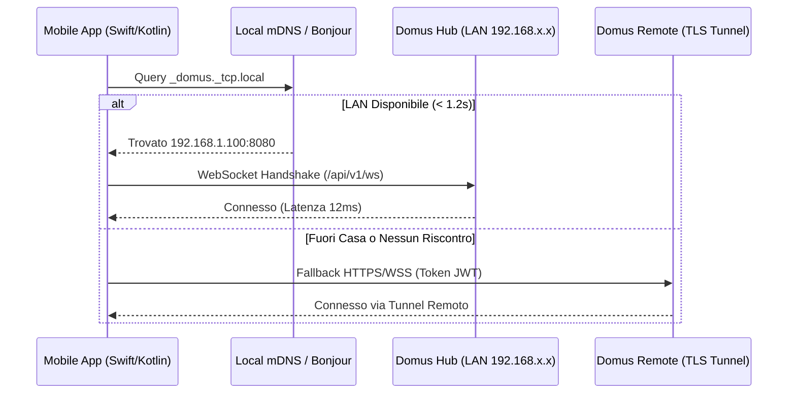
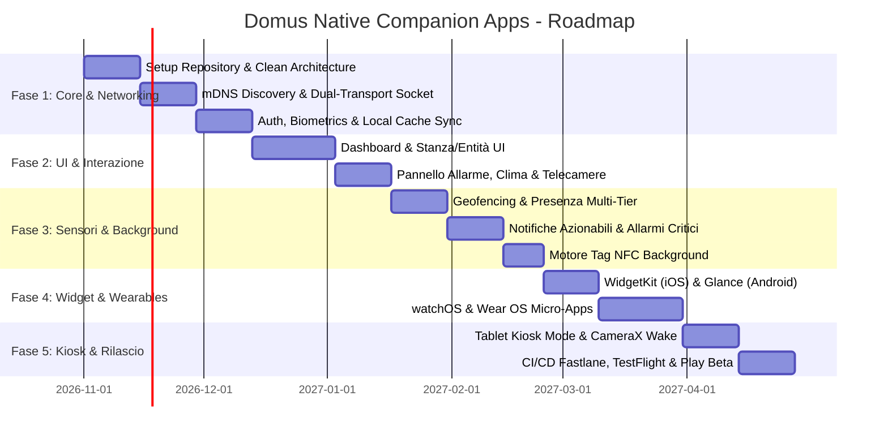

# Domus Native Mobile Companion Apps: Architectural & Implementation Plan

> **Obiettivo**: Progettare e sviluppare le applicazioni companion **100% native** per **iOS** (Swift 6 + SwiftUI) e **Android** (Kotlin 2.x + Jetpack Compose), garantendo prestazioni a 60/120Hz ProMotion, latenza sub-millisecondo in rete locale, integrazioni di sistema profonde (Widget interattivi, Geofencing, Notifiche azionabili, Allarmi critici, Tag NFC, Wearables e Tablet Kiosk Mode) e zero dipendenze da framework ibridi/WebView.

---

## 1. Perché 100% Nativo (Native vs Hybrid Rationale)

Sebbene la Web App PWA di Domus offra un'interfaccia ricca, le funzionalità di automazione domestica di livello enterprise richiedono capacità di sistema non accessibili o instabili nelle sandbox Web/PWA:

| Capacità di Sistema | Web PWA / Capacitor | iOS Nativo (SwiftUI) | Android Nativo (Jetpack Compose) |
| :--- | :--- | :--- | :--- |
| **Frame Rate & Fluidità** | 60Hz limitato dal browser | **120Hz ProMotion** costante | **120Hz Adaptive Refresh** |
| **Avvio a Freddo (Cold Start)** | 1.2s - 2.5s (parsing JS/DOM) | **< 250ms** pre-compilato | **< 300ms** Baseline Profile |
| **Scoperta LAN (mDNS / Bonjour)** | Non supportato nel browser | **NWBrowser (`_domus._tcp`)** | **NsdManager (Zero-Config)** |
| **Allarmi Critici (Bypass Silenzioso)** | Impossibile | **APNs Critical Alert Entitlement** | **NotificationChannel Urgent + Alarm** |
| **Geofencing & Presenza in Background** | Inaffidabile (OS killa il browser) | **CoreLocation Significant Visits** | **FusedLocationProvider + Geofence** |
| **Scansione NFC in Background** | Richiede app aperta | **CoreNFC Background Tag Reading** | **NFC Intent Filter (`ACTION_NDEF`)** |
| **Widget Schermata Home / Blocco** | Non supportato | **WidgetKit (iOS 17/18 Interattivo)** | **Glance AppWidget (Jetpack)** |
| **Centro di Controllo / Quick Settings** | Non supportato | **iOS 18 ControlWidget** | **Quick Settings TileService** |
| **Wearables (Apple Watch / Wear OS)** | Non supportato | **watchOS App Standalone** | **Wear OS Compose Tiles** |
| **Tablet Kiosk (Parete)** | Richiede browser kiosk | **Guided Access + Proximity** | **Lock Task Mode + CameraX Wake** |

---

## 2. Architettura Software Condivisa (Clean Architecture + MVI/MVVM)

Entrambe le codebase adotteranno la medesima struttura modulare **Clean Architecture**, facilitando il debug e la consistenza funzionale tra i team.

```
┌─────────────────────────────────────────────────────────────┐
│                    Presentation Layer                       │
│   SwiftUI Views / Jetpack Compose Components                │
│   ViewModels (StateFlow / @Observable)                      │
│   Interactive Widgets (WidgetKit / Glance)                  │
└──────────────────────────────┬──────────────────────────────┘
                               │
┌──────────────────────────────▼──────────────────────────────┐
│                      Domain Layer                           │
│   UseCases (ToggleEntity, SyncState, HandleGeofence)        │
│   Domain Models (Entity, Device, Area, Alarm, Scene)         │
│   Repository Interfaces                                     │
└──────────────────────────────┬──────────────────────────────┘
                               │
┌──────────────────────────────▼──────────────────────────────┐
│                       Data Layer                            │
│   Local Cache: SwiftData / Room (Offline-First)             │
│   Network Client: URLSession / Ktor HTTP + WebSocket        │
│   Hardware Bridges: CoreLocation, CoreNFC, Biometrics       │
│   mDNS Engine: Local Hub Resolver (_domus._tcp.local)       │
└─────────────────────────────────────────────────────────────┘
```

---

## 3. Matrice Tecnologica per Piattaforma

### 3.1 Stack Tecnologico iOS (Apple Ecosystem)
- **Linguaggio & Runtime**: Swift 6, Swift Concurrency nativa (`async/await`, `AsyncStream`, `Actor`).
- **UI Framework**: SwiftUI (iOS 17+, iOS 18 ready) con `@Observable` macro (nuovo observation framework).
- **Persistenza Locale**: SwiftData + ModelContext (cache offline istantanea delle entità e delle stanze).
- **Rete & Streaming**:
  - `URLSessionWebSocketTask` con protocollo di riconnessione automatica ad esponenziale backoff.
  - `Network.framework` (`NWBrowser` / `NWPathMonitor`) per scoprire `_domus._tcp.local` e monitorare Wi-Fi vs Dati Mobili.
- **Integrazioni Hardware**:
  - `CoreLocation`: Geofencing circolare ad alta efficienza energetica + Significant Motion.
  - `UserNotifications`: Notifiche azionabili, payload immagini snapshot e allarmi critici.
  - `CoreNFC`: Lettura passiva e in background di tag NFC `domus://tag/{id}`.
  - `WidgetKit` & `AppIntents`: Widget interattivi sulla schermata home e blocco; controlli Centro di Controllo in iOS 18 (`ControlWidget`).
  - `WatchKit` (`WatchConnectivity`): App autonoma per Apple Watch con complicazioni quadrante.
  - `LocalAuthentication`: Face ID / Touch ID per autenticazione e disarmo allarme.

### 3.2 Stack Tecnologico Android (Google Ecosystem)
- **Linguaggio & Runtime**: Kotlin 2.1+, Kotlin Coroutines & `StateFlow`/`SharedFlow`.
- **UI Framework**: Jetpack Compose con Material Design 3 (Dynamic Theming / Material You).
- **Persistenza Locale**: Room DB con crittografia SQLCipher (cache offline sincronizzata).
- **Iniezione Dipendenze**: Google Hilt / Koin.
- **Rete & Streaming**:
  - Ktor Client / OkHttp WebSocket con heartbeat bidirezionale e serializzazione kotlinx.serialization.
  - `NsdManager` (Network Service Discovery) per rilevare il server Domus su mDNS locale.
  - `ConnectivityManager.NetworkCallback` per intercettare il collegamento al Wi-Fi di casa.
- **Integrazioni Hardware**:
  - `Google Play Services Location`: `GeofenceManager` + Fused Location Provider.
  - `Firebase Cloud Messaging (FCM)`: Canali di notifica ad alta priorità (Heads-up) e allarme sonoro dedicato.
  - `Android NFC Framework`: `NfcAdapter.enableReaderMode` + Intent Filter per broadcast passivo.
  - `Glance AppWidget`: Widget reattivi in Compose per la schermata home.
  - `TileService`: Riquadri rapidi nei Quick Settings (tendina superiore) per luci e scenari.
  - `Wear OS Compose`: App smartwatch con Tiles e Complicazioni.
  - `BiometricPrompt`: Impronta digitale e sblocco facciale biometrico.

---

## 4. Specifiche Dettagliate delle Funzionalità Native

### 4.1 Motore di Connessione a Bassa Latenza (Dual-Transport Local/Remote)
L'app companion implementa un orchestratore di connettività intelligente a transizione trasparente:
1. **Rilevamento Locale Istantaneo**:
   - All'apertura dell'app, se il dispositivo è connesso al Wi-Fi, il motore invia una query mDNS per il servizio `_domus._tcp.local`.
   - Se il server risponde, l'app si connette direttamente all'IP locale (es. `http://192.168.1.100:8080`) via WebSocket. Latenza comandi: **< 15 millisecondi**.
2. **Fallback Remoto Trasparente**:
   - Se l'utente esce di casa o mDNS non risponde entro 1.2 secondi, l'app passa all'endpoint remoto sicuro configurato (WireGuard, Cloudflare Tunnel o Reverse Proxy TLS).
   - Transizione zero-glitch: la UI continua a mostrare l'ultimo stato salvato in SwiftData/Room e ri-sincronizza i delta di stato non appena il socket remoto è stabilito.



### 4.2 Multi-Tier Presence & Geofencing a Batteria Zero
L'algoritmo di rilevamento presenza nativo supera le limitazioni dei sistemi convenzionali:
- **Livello 1 (Rete Wi-Fi Locale)**: L'app registra un callback sul cambio SSID di rete. Nel momento in cui lo smartphone si aggancia al Wi-Fi domestico (es. `Casa_5GHz`), invia all'istante l'evento `presence: home` al server Domus.
- **Livello 2 (Geofencing Circolare)**: Viene definita una geofence con raggio configurabile (es. 150 metri) attorno alle coordinate dell'abitazione. Quando lo smartphone entra o esce dal perimetro, il sistema operativo risveglia l'app in background per 10 secondi per comunicare il cambio stato.
- **Livello 3 (Visit Monitoring & Beacon BLE)**: Su iOS, `CLVisit` rileva periodi prolungati di permanenza; su entrambi i sistemi operativi, il modulo BLE Proxy rileva gli iBeacon o i pacchetti Bluetooth emessi da Domus o dallo smartwatch per determinare la stanza esatta in cui si trova l'utente.

### 4.3 Notifiche Interattive & Allarmi Critici (Critical Alerts)
- **Notifiche Azionabili con Bottoni Rapidi**:
  - Le notifiche push includono bottoni contestuali definiti da categorie backend:
    - Esempio Notifica: *"Rilevata finestra aperta in salotto e pioggia in arrivo."*
    - Azione 1: `[Chiudi Tapparelle]` -> Invia comando `cover.close` via webhook diretto senza aprire l'app.
    - Azione 2: `[Ignora per 1h]` -> Snooze allerta.
  - Allegato Rich Media: Se l'allarme è generato da una telecamera, la notifica include la snapshot JPEG o la GIF animata dei 3 secondi dell'evento.
- **Allarmi Critici (Bypass Silenzioso)**:
  - Per allarmi antincendio, perdite di gas, sensori allagamento o intrusione allarme armato:
    - Su iOS: Richiesta dell'entitlement `com.apple.developer.usernotifications.critical-alerts`. La notifica suona a volume massimo (100%) anche se l'iPhone è in modalità *"Non disturbare"* o con lo switch fisico del silenzioso attivo.
    - Su Android: Canale di notifica con `IMPORTANCE_HIGH`, allarme audio continuo gestito con `RingtoneManager` e visualizzazione a pieno schermo (*Heads-up Notification*).

### 4.4 Tag NFC & QR Code Fisici
- Supporto a qualsiasi tag adesivo NTAG213 / NTAG215 / NTAG216 economico (pochi centesimi di euro).
- L'app permette di associare un tag NFC fisico a un'entità, scena o automazione:
  - Es. Tag sul comodino: *"Scena Buonanotte (spegni tutte le luci, abbassa tapparelle, arma allarme notte)"*.
  - Es. Tag vicino alla porta: *"Disarma allarme / Apri portoncino"*.
- **Lettura in Background**:
  - Su iPhone (dal modello XS in poi) e smartphone Android moderni con NFC, non è necessario aprire l'applicazione: basta accostare lo smartphone al tag bloccato. Il sistema operativo legge il payload NDEF `domus://tag/{id}` ed esegue l'automazione in background con conferma haptic.

### 4.5 Interactive Home Screen Widgets & Controlli Rapidi
- **iOS WidgetKit (iOS 17+)**:
  - Widget interattivi di dimensione Piccola, Media e Grande.
  - L'utente può toccare direttamente il pulsante di una lampada o della presa sul widget della schermata home senza che si apra l'app (eseguito via `AppIntent`).
  - Widget Schermata di Blocco (Lock Screen): indicatore temperatura stanza, stato allarme o pulsante rapido per aprire il cancello.
  - **iOS 18 ControlWidget**: Aggiunta di bottoni personalizzati nel Centro di Controllo di iOS trascinabili a piacere.
- **Android Glance AppWidgets**:
  - Widget scritti in Jetpack Compose con supporto al Material You Dynamic Color.
  - Quick Settings Tile: 4 riquadri nella tendina di notifica Android per le 4 azioni preferite (Cancello, Luce Giardino, Scenario Uscita, Allarme).

### 4.6 App per Wearables (Apple Watch & Wear OS)
- **watchOS**:
  - Complicazioni per il quadrante: Mostrano la temperatura interna, la potenza assorbita istantanea (kW) e l'icona dell'allarme.
  - Applicazione standalone sull'orologio: griglia delle scene preferite e controlli vocali rapidi via microfono dell'Apple Watch collegati all'assistente locale LLM di Domus.
- **Wear OS**:
  - Wear OS Tiles: Scorrimento laterale dalla schermata dell'orologio per mostrare i controlli rapidi della casa.
  - Complicazioni circolari e lineari per quadranti digitali.

### 4.7 Modalità Kiosk per Tablet a Parete
Per gli utenti che montano un tablet Android economico o un iPad all'ingresso come pannello domotico fisso:
- **Schermo Sempre Attivo con Sleep Intelligente**: Mantiene acceso lo schermo durante il giorno; attiva uno screensaver a bassa luminosità (orologio minimale e meteo) durante la notte.
- **Risveglio con Prossimità**: Tramite la fotocamera frontale o il sensore di luminosità (CameraX su Android), il tablet accende lo schermo automaticamente quando una persona si avvicina a meno di 1.5 metri.
- **Blocco Applicazione (Kiosk Lock)**: Utilizzo della modalità *Lock Task* (Android Device Policy) o *Accesso Guidato* (iOS) per impedire a ospiti o bambini di uscire dall'interfaccia Domus.
- **Protezione della Batteria**: Notifica o comando intelligente collegato a una presa smart Shelly che stacca l'alimentazione del tablet quando la batteria raggiunge l'80% e la riattiva al 20%, prevenendo il rigonfiamento delle batterie al litio.

---

## 5. Piano di Implementazione & Roadmap a Fasi



### Dettaglio delle Fasi di Sviluppo

#### **Fase 1: Fondamenta, Rete & Sincronizzazione Locale (Mese 1)**
- Creazione dei repository `domus-ios` (Xcode 16, Swift 6) e `domus-android` (Android Studio Ladybug, Kotlin 2.1).
- Implementazione modulo mDNS per auto-discovery del server locale `_domus._tcp.local`.
- Modulo di rete WebSocket a due canali (LAN con IP diretto vs Remoto protetto con TLS e token crittografato nel Portachiavi iOS / Android Keystore).
- Sincronizzazione entità e cache locale offline-first (SwiftData / Room DB).

#### **Fase 2: Interfaccia Utente Reattiva & Controlli Domestici (Mese 2)**
- Riproduzione nativa ad altissime prestazioni delle schede entità:
  - Luci con selezione colore HSL e luminosità fluida.
  - Interruttori e prese con visualizzazione istantanea potenza (W) e grafico consumi.
  - Termostato circolare interattivo con feedback aptico per impostazione temperatura.
  - Tastierino allarme con codice PIN, inserimento parziale/totale e ritardo acustico.
  - Streaming telecamere live a bassissima latenza (RTSP / WebRTC nativo).

#### **Fase 3: Background, Geofencing, Notifiche & NFC (Mese 3)**
- Geofencing a basso consumo con integrazione della presenza multi-tier di Domus.
- Ricezione notifiche push APNs / FCM con bottoni di risposta rapida (Actionable Notifications).
- Abilitazione Allarmi Critici con bypass della modalità silenziosa su entrambi i sistemi operativi.
- Scansione e scrittura tag NFC con esecuzione scenari a schermo bloccato.

#### **Fase 4: Widget, Control Center & Smartwatch (Mese 4)**
- Widget iOS (WidgetKit con AppIntents) e Android (Glance) per controllo diretto da schermata home.
- Aggiunta controlli nel Centro di Controllo (iOS 18 `ControlWidget`) e nei Quick Settings (Android `TileService`).
- Sviluppo companion app watchOS e Wear OS con complicazioni e quadranti personalizzati.

#### **Fase 5: Modalità Kiosk, TestFlight & Google Play Beta (Mese 5)**
- Modalità Kiosk per tablet a parete con risveglio tramite fotocamera e protezione batteria.
- Pipeline CI/CD automatizzata tramite **Fastlane** e **GitHub Actions**:
  - Compilazione automatica e deploy delle build su **Apple TestFlight** per beta tester iOS.
  - Distribuzione automatica su **Google Play Console (Internal App Sharing & Open Testing)**.
